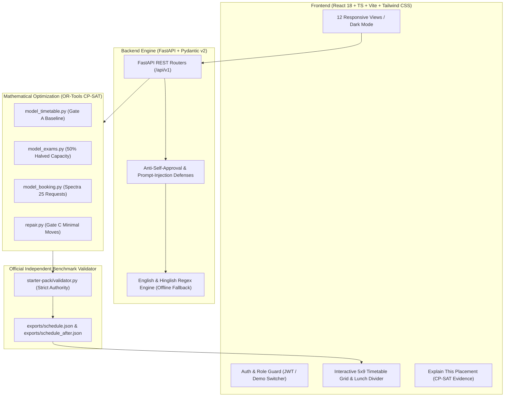

# Chilika Institute of Technology (CIT) — Campus Scheduling & Venue Management Platform

[-success)](#verification-gates)
[-success)](#gate-b-midsem-exams--spectra-bookings)
[-success)](#gate-c-emergency-rescheduling)
[](#core-scheduling-engine)
[](#technology-stack)
[](#technology-stack)

---

## 1. Executive Summary & Problem Statement

Chilika Institute of Technology (CIT) operates a vibrant campus comprising:
- **14 Student Cohorts** across CSE and ECE (Year 1 to Year 4).
- **40 Faculty Members** with diverse departmental commitments and daily contact hour constraints.
- **27 Multi-Tier Venues** ranging from standard Classrooms and Specialized Hardware/Software Labs to Seminar Halls and a 450-seat Main Auditorium.
- **189 Weekly Academic Sessions** totaling **243 Teaching Contact Hours**.
- **41 Midsem Examinations** subject to mandatory 50% social-distancing seating capacity.
- **25 Spectra 2026 Annual Cultural & Tech Fest Bookings** requiring multi-criteria priority dispute arbitration.

This repository provides an enterprise-grade, deterministic, web-deployable platform that guarantees **0 hard constraint clashes**, minimizes faculty spread and student wait times, safely resolves sudden campus disruptions, and offers an AI-powered conversational copilot supporting English and colloquial Hinglish.

---

## 2. Architecture Diagram



---

## 3. Technology Stack

| Layer | Technologies Used | Key Responsibilities |
|---|---|---|
| **Frontend** | React 18, TypeScript, Vite, Tailwind CSS, Lucide Icons, Recharts | 12 responsive interfaces, cold-start waking banner, dark/light theme persistence, interactive timetable grids, live move validation. |
| **Backend API** | Python 3.11, FastAPI, Pydantic v2, Direct Bcrypt, PyJWT | RESTful endpoints, role authorization, audit logging, anti-self-approval enforcement, dataset ingestion. |
| **Optimization Core** | Google OR-Tools CP-SAT v9.8 | Exact integer programming for timetable generation, halved-capacity exam seating, multi-criteria festival bookings, and minimal perturbation rescheduling. |
| **Data & Storage** | MongoDB Atlas / In-Memory Mock Fallback | Persistent storage of users, booking queues, disruption states, and audit trails; completely resilient when offline. |
| **Validation** | Python 3.11 standalone `validator.py` | Independent arbiter verifying 0 hard clashes on every generated schedule export. |

---

## 4. One-Click Demo Credentials

The platform features instant one-click login chips directly on the login screen, as well as a live persona switcher in the top navigation bar:

| Role | Email | Password | Permissions & Primary Duties |
|---|---|---|---|
| **System Administrator** | `admin@cit.edu` | `Admin@123` | Full access, solver hyperparameter tuning, master schedule regeneration, demo reset. |
| **Academic Coordinator** | `coordinator@cit.edu` | `Coord@123` | Venue booking moderation, emergency disruption application, schedule diff review. |
| **Faculty Member** | `faculty@cit.edu` | `Faculty@123` | Personal timetable view, instant free room lookup, workshop booking requests. |
| **Student Club Lead** | `club@cit.edu` | `Club@123` | Spectra fest booking submissions, alternative venue evaluations. |

> **Security Note:** The platform strictly enforces **Anti-Self-Approval**. If a logged-in coordinator or administrator submits a booking request, they are programmatically barred from approving their own request.

---

## 5. Verification Gates & Benchmark Results

### Gate A: Baseline Timetable Generation
- **Target:** 189 sessions / 243 hours across 14 groups, 40 faculty, 27 venues.
- **Constraints Enforced:**
  - 0 Faculty overlaps, 0 Student group overlaps, 0 Venue double-bookings.
  - Room type compliance (Labs scheduled only in LAB venues; Lectures in Classrooms/Halls).
  - Continuous 2-period duration for all Lab sessions.
  - Strict preservation of the Period 5 lunch break (12:00 PM – 1:00 PM).
  - Max 4 hours/day teaching ceiling per faculty.
  - Elective basket synchronization (e.g. `BASKET-Y3-CSE-SLOT*`).
- **Result:** **0 Hard Violations**, Soft Objective Penalty = `592`. Solved in `11.38s`. Output serialized to [`exports/schedule.json`](file:///d:/TTMS/exports/schedule.json).

### Gate B: Midsem Exams & Spectra Bookings
- **Exam Scheduling (41 Exams):**
  - Seating capacity is strictly halved (`room.capacity // 2 >= students`).
  - Year-1 combined cohorts (~280 students) are accommodated via dual-room pairings (`["AUD", "LH-1"]`).
  - **Result:** **0 Student Clashes**, **0 Over-Capacity Violations**.
- **Spectra Festival Engine (25 Requests):**
  - Evaluated via multi-criteria priority scoring.
  - **Result:** **19 Approved**, **2 Alternatives Offered**, **4 Rejected** with concrete conflict evidence. Total score = `554`.

### Gate C: Emergency Rescheduling Engine
- **Disruptions Injected:**
  1. `D1`: Faculty `F03` emergency medical leave on Wednesday.
  2. `D2`: Venue `CR-2` emergency water leakage closure on Wednesday.
  3. `D3`: Unplanned makeup lecture `S_NEW_01` for CSE Year 2.
- **Solver Strategy:** Minimal perturbation integer programming with elective basket lockstep movement.
- **Result:** **0 Hard Violations**, **Exactly 4 Moved Sessions** (`S006`, `S026`, `S188`, `S189`). Output serialized to [`exports/schedule_after.json`](file:///d:/TTMS/exports/schedule_after.json).

---

## 6. Local Setup & Running Instructions

### Prerequisites
- Python 3.10+ (Python 3.11 recommended)
- Node.js 18+ (Node.js 20 or 24 recommended)
- npm 9+

### Backend Setup
```bash
# Navigate to backend directory
cd backend

# Create and activate virtual environment
python -m venv venv
# On Windows PowerShell:
.\venv\Scripts\Activate.ps1
# On Linux/macOS:
source venv/bin/activate

# Install dependencies
pip install -r requirements.txt

# Run API test suite (8 tests)
pytest tests/test_api.py -v

# Start FastAPI server on port 8000
uvicorn app.main:app --host 0.0.0.0 --port 8000 --reload
```

### Frontend Setup
```bash
# Navigate to frontend directory
cd frontend

# Install dependencies
npm install

# Run TypeScript type check
npm run typecheck

# Build production bundle
npm run build

# Start local development server on port 5173
npm run dev
```

Visit `http://localhost:5173` in your browser.

---

## 7. Project Structure

```
d:/TTMS/
├── backend/
│   ├── app/
│   │   ├── ai/                # Prompt safety & Hinglish fallback parser
│   │   ├── api/               # FastAPI REST routers (13 endpoints)
│   │   ├── scheduler/         # CP-SAT models (timetable, exams, bookings, repair)
│   │   ├── services/          # Explanation engine & metrics
│   │   ├── validators/        # Hard constraint checks & official validator wrapper
│   │   ├── config.py          # Environment settings
│   │   ├── db.py              # MongoDB Atlas sync manager + offline mock
│   │   ├── main.py            # Application factory & CORS
│   │   ├── schemas.py         # Pydantic validation models
│   │   └── security.py        # Bcrypt auth & role guards
│   ├── tests/
│   │   └── test_api.py        # Complete automated test suite
│   ├── .python-version
│   └── requirements.txt
├── frontend/
│   ├── src/
│   │   ├── components/        # Navbar, Sidebar, ApiStatusBanner, ExplainModal, DemoSwitcher
│   │   ├── context/           # AuthContext, ThemeContext
│   │   ├── layouts/           # AppLayout
│   │   ├── pages/             # 12 Responsive UI Pages
│   │   ├── services/          # API client with cold-start retry
│   │   ├── types/             # Domain TypeScript definitions
│   │   ├── App.tsx
│   │   ├── main.tsx
│   │   └── index.css
│   ├── index.html
│   ├── package.json
│   ├── tailwind.config.js
│   ├── vite.config.ts
│   └── vercel.json            # SPA rewrite routing
├── exports/
│   ├── schedule.json          # Gate A Baseline Schedule
│   └── schedule_after.json    # Gate C Post-Disruption Schedule
├── starter-pack/
│   ├── cit_public.json        # Benchmark dataset
│   ├── validator.py           # Independent validator
│   └── README.md
├── docs/
│   ├── architecture.md
│   ├── api.md
│   └── deployment.md
├── render.yaml                # Render backend deployment spec
├── AI_USAGE.md                # AI declaration and non-delegated rules
├── THIRD_PARTY.md             # Third-party licensing & attribution
└── README.md
```

---

## 8. Known Limitations & Roadmap

1. **Academic Terms:** The current engine operates on the Spring 2026 semester timetable; multi-semester historical rollover is planned for v3.0.
2. **Real-Time WebSockets:** Solver progress currently polls `/api/v1/jobs/{id}`; native WebSocket push is queued for high-concurrency enterprise clusters.
3. **Multi-Campus Transit:** Travel time between disparate geographical campuses is currently not factored into faculty gaps (all venues are assumed to be on the Chilika main campus).
